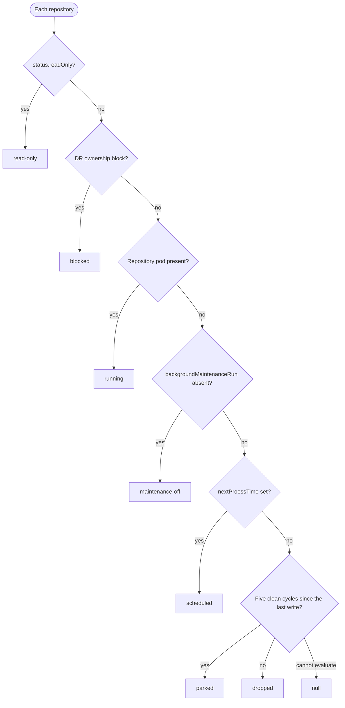
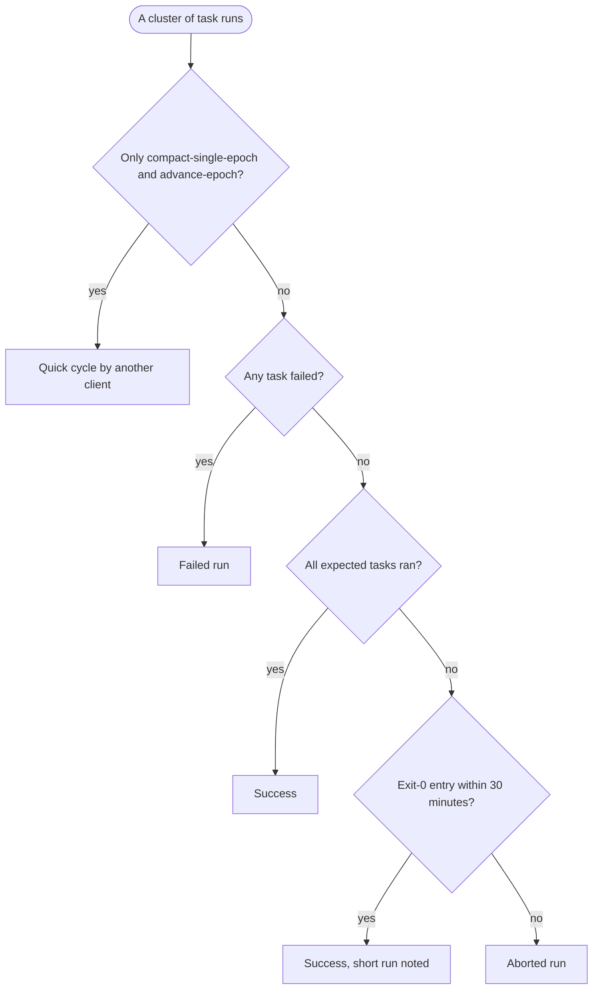
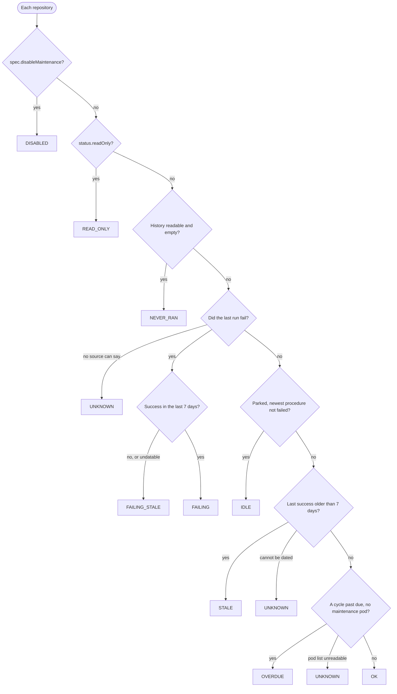
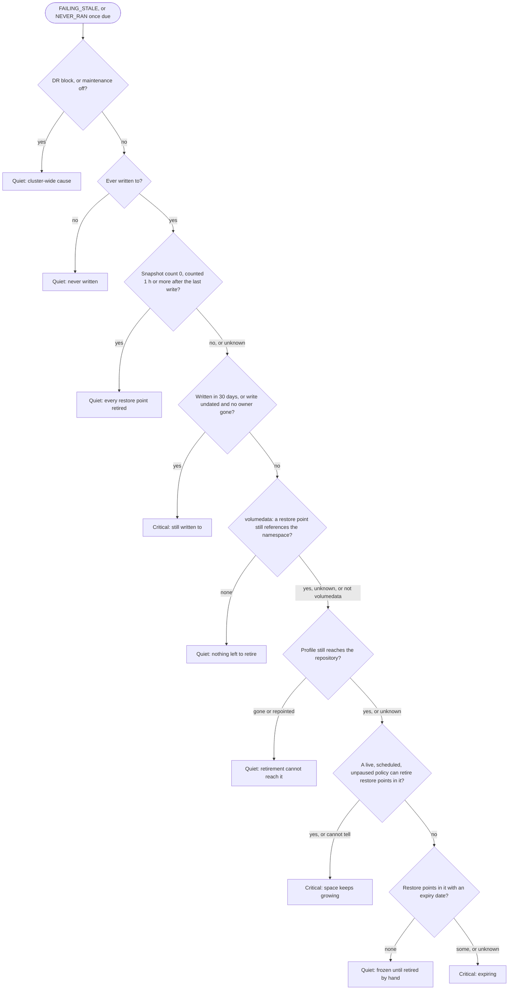

# Repository maintenance checks

This page tells you how KDL judges Kopia maintenance on each Kasten
StorageRepository, and why. Read it before you change the
`storageRepositories` section of `KDL.sh` or its rendering in
`kdl-json-to-html.sh`.

It describes KDL 2.7.2 on Kasten 9.0. KDL is read-only: it never writes to,
deletes or starts anything on the cluster.

## The question KDL answers

**Is full Kopia maintenance succeeding on this repository?**

The key word is *succeeding*. Old versions read the newest maintenance
timestamp and called the repository healthy if it was recent. That is wrong.
Kasten adds an entry to `maintenanceRun.recentResults` only when
`kopia maintenance run --full` exits 0. A failed run adds nothing. So the last
success keeps its timestamp, and it looks fresh for up to a week while every
run fails.

So KDL builds each status from evidence that a run succeeded. When it cannot
find that evidence, it says so. It never assumes the good outcome.

## Where the evidence comes from

| Source | What it holds | What it cannot see |
| --- | --- | --- |
| `maintenanceInfo.runs` | Each task of each Kopia run, with its own success flag and times. Up to 50 per task. | A run that never started. If the pod could not start, Kopia records no task. |
| `processResults` | Each procedure Kasten ran on the repository, with `succeeded` and the result of each command in it. | Old history. It keeps 10 entries, and storage scans share them, so scans push out maintenance records within hours. |
| `maintenanceRun.recentResults` | One entry for each full run that exited 0. Five deep. Scans never push it out. | Failures, by design. On its own, it cannot say which run an entry belongs to. |

KDL matches each exit-0 entry to its task run: the run whose end is nearest
the entry's `completedTime`, within 30 minutes. Two writers make these
records, and their clocks can drift. If no run is in the window, or the
matched run has a failed task, KDL sets
`evidenceConflicts: exit-zero-unsupported`, and that entry dates nothing.

## What KDL reads

KDL fetches all of this for the report anyway. The two ConfigMaps are single
reads under the ConfigMap permission KDL already has. No extra RBAC is needed.

| Object | Fields |
| --- | --- |
| StorageRepository list | `status.readOnly`, `status.processResults`, `status.location`, `status.contentType`, labels (`appName`, `exportProfile`, `importProfile`, `policyName`, `policyNamespace`), `spec.disableMaintenance`, `spec.overrideLocation` |
| `/details` subresource | `modifiedTime`, `nextProessTime`, `kopiaMeta.maintenanceInfo`, `kopiaMeta.maintenanceRun.recentResults`, `kopiaMeta.storageUsage` |
| Pods in the Kasten namespace | Maintenance, upgrade and scan pods, with phase and start time |
| Policies (all namespaces) | `spec.paused`, the profile of every export and backup action, the selector |
| Namespaces | Name to UID, to find a namespace that was deleted and created again |
| RestorePointContents | `appNamespace`, `exportProfile`, `blockModeExportProfile`, `importProfile`, `exportType`, `policyName`, `policyNamespace`, `runActionName` and `expiresAt` labels |
| ConfigMaps | `k10-dr-remove-to-get-ownership` and `k10-features` |

Three payload facts catch people out:

- **The field is `nextProessTime`.** Kasten misspells it in its source. KDL
  publishes it as `nextProcessTime`. If it is absent, K10 holds no timer.
- **`status.details` is only on the `/details` subresource.** The list object
  does not have it. KDL makes one `/details` call per repository, in parallel
  (`KDL_PARALLEL`, default 10).
- **Publish the location name only.** `status.location` paths contain the
  cluster UUID, so KDL publishes the bucket or claim name in `target`, and
  `locationType` says which kind it is.

### What moves `modifiedTime`

`modifiedTime` is the last time something wrote to the repository. These
events move it:

- exports and imports;
- Kanister-artifact retirement and Generic Volume Snapshot deletion;
- repository format upgrades.

These events do not move it: data-mover snapshot retirement, collection
retirement, maintenance and storage scans.

So a repository whose restore points retire through the data mover can look
idle while its unreclaimed space grows. That is why idleness alone never
lowers a severity (see [The severity gate](#the-severity-gate)).

## Cluster-wide preconditions

Two settings decide if K10 maintains any repository at all. KDL reads both
before it judges a single repository, and publishes them in
`k10MaintenancePreconditions`. The DR block outranks the feature flag.

### The DR ownership block

Every Kasten DR restore creates the ConfigMap
`k10-dr-remove-to-get-ownership`. While it exists, K10 processes no
repository: no maintenance, no scan, no timer, no pod. Backups and exports
continue, so the repositories grow without maintenance. On a restored cluster
the history is the source cluster's, and it can look fresh.

- Every repository reads `k10SchedulerState: blocked`.
- Every eligible failure is quiet (`dr-ownership-block`).
- The section verdict is `BLOCKED_DR_OWNERSHIP`. It stays a warning at any
  age. A critical would push the reader to delete the ConfigMap, and two
  owners can corrupt backup data. The age in the sentence shows the urgency.

### Background maintenance off

The `backgroundMaintenanceRun` key in the ConfigMap `k10-features` turns
background maintenance on by being present. K10 reads the key, not its value,
so `"false"` still turns it on. If the key is absent, K10 runs storage scans
only.

- Every repository reads `k10SchedulerState: maintenance-off`.
- Every eligible failure is quiet (`maintenance-feature-off`).
- The section verdict is `DISABLED_BY_CONFIG`, a warning.
- If `k10-features` itself is missing, KDL reports "not checked". Helm always
  creates it, so its absence tells you nothing about the flag.

### How KDL reads them

- **The object proves presence, never the exit code.** A ConfigMap counts as
  present only when the read returns that ConfigMap.
- **A failed read is "not checked", never "absent".** KDL publishes only the
  server status word, for example `DR ownership block not checked (Forbidden).`
- **The report names what to change, never a command.** It names the
  ConfigMap and the dashboard action, or the Helm value. A wrong command in a
  support report does more harm than none, and removing the DR block is
  destructive.

## What K10 is doing: `k10SchedulerState`

Each repository gets one state. The first match wins.

| State | When | What it means |
| --- | --- | --- |
| `read-only` | `status.readOnly` is true | An import repository. K10 never processes it on this cluster. |
| `blocked` | The DR ownership block exists | K10 processes nothing. Cluster-wide, so it outranks the pod and the timer. |
| `running` | A repository pod is present, Pending included | K10 clears the timer while a procedure runs, so the pod is the evidence. |
| `maintenance-off` | `backgroundMaintenanceRun` is absent | Scans only. Below `running` because scans still run. |
| `scheduled` | `nextProessTime` is set | K10 holds a timer. |
| `parked` | No timer, and the park rule holds | Healthy by design (see below). |
| `dropped` | No timer, not parked, details and pod list readable | K10 gave up on it, or never armed it. |
| null | KDL cannot tell | The details, the pod list or a park-rule input could not be read. Null, never `dropped`. |

### Parking

K10 parks a repository when five `maintenanceRun.recentResults` have
`scheduledTime >= modifiedTime` and every task since the earliest of them
succeeded. A parked repository has no timer until the next write. KDL
publishes the rule's result as `k10Parked`.

### Giving up

K10 gives up on a failing repository in one of two ways:

- **Shape one.** Kopia never reaches the point where it schedules the next
  run. K10 tries 10 times in about 45 minutes, then keeps no timer. A terminal
  error, for example a deleted profile, gets one attempt per trigger.
- **Shape two.** The maintenance command fails after it scheduled the next
  run, while the other four commands succeed. The timer starts again a day
  later. You see a live timer and one failure per day.

At start-up, K10 also skips a repository if all ten of its kept process
results failed at or after its last write. On shape two, a `crypto-svc`
restart therefore *stops* the daily retries. KDL publishes this as
`k10RestartWontHelp` (true or null, never false), and the row says so.

A timer more than 5 minutes in the past with no pod is not normal. KDL
publishes it as `k10TimerOverdueSeconds`.

### The pods

| Pod | What it does | Excuses an overdue run? |
| --- | --- | --- |
| `<repo>-owner`, annotation `repository-operations` | Full maintenance. Deleted when the run ends. | Yes |
| `<repo>-owner`, annotation `upgrade-repository` | Format upgrade. Holds the owner name, so maintenance cannot run beside it. | Yes, but it is never reported as maintenance |
| `repo-access-<repo>` | Storage scans and quick operations. Never full maintenance. | No |

The pod name is the only link to the repository. The ownerRef points to
`crypto-svc`. Kasten writes the StorageRepository object once, when the run
ends, so the owner pod is the only sign of a run in progress.

## Judging a run

A full run is a cluster of tasks in `maintenanceInfo.runs`. Eight tasks are
always there:

`snapshot-gc`, `full-drop-deleted-content`, `compact-single-epoch`,
`advance-epoch`, `generate-epoch-range-index`, `cleanup-epoch-markers`,
`delete-superseded-epoch-indexes`, `cleanup-logs`

One of `full-delete-blobs` and `full-rewrite-contents` is added. They take
turns, one each day. The first full maintenance of a repository has no
`full-drop-deleted-content`.

KDL derives the expected task set for each repository, and never hard-codes
it. The set is the tasks found in 90 % or more of that repository's own
recent runs. KDL leaves out the newest run, so a failing run cannot lower the
bar for itself. It also leaves out the oldest run, because a first run
legitimately has one task fewer. An empty set means no floor, not "all
pass".

- **Short, and it exited 0:** a success. Kopia exits non-zero on any task
  failure, so it skipped a conditional task. If every kept run is short, the
  row says so (`shortRuns`, `missingTasks`).
- **Short, and it never exited 0:** an abort. A timeout or an OOM kill stopped
  Kopia partway.
- **Quick cycle:** K10 runs only full maintenance, so another client ran it.
  KDL keeps it out of every full-run judgement and reports it.

Show task counts without a fraction when the run is complete: "9 tasks ran",
never "9/8". Show a fraction only for a short run: "3 of 8 expected tasks
ran".

For duration, use the inner MaintenanceRun command's `endTime - startTime`.
`completedTime - scheduledTime` includes queue time and is 4 to 5 times too
long.

## Statuses

Each repository gets exactly one status. KDL checks them in this order, and
the first match wins.

| # | Status | When |
| --- | --- | --- |
| 1 | `DISABLED` | `spec.disableMaintenance` is true |
| 2 | `READ_ONLY` | `status.readOnly` is true |
| 3 | `NEVER_RAN` | The history is readable and empty, and no procedure is on record |
| 4 | `UNKNOWN` | No source can say if the last run failed |
| 5 | `FAILING_STALE` | The last run failed, and no success in 7 days |
| 6 | `FAILING` | The last run failed, but a success is recent |
| 7 | `IDLE` | K10 parked it, and the newest procedure did not fail |
| 8 | `STALE` | The last success is older than 7 days |
| 9 | `UNKNOWN` | It succeeded, but the success cannot be dated |
| 10 | `OVERDUE` | More than a full cycle past due, no maintenance pod, nothing recorded |
| 11 | `UNKNOWN` | Past due, and the pod list could not be read |
| 12 | `OK` | A success within 7 days, nothing failing or overdue |

"Did the last run fail?" takes the first source that has an answer: the inner
maintenance command, then the procedure record, then the task history. "When
did it last succeed?" comes from the task history. If that cannot be read,
it comes from the newer of the exit-0 record and the procedure record.

Notes on single statuses:

- **`DISABLED`** keys on `spec.disableMaintenance` only. Kopia's own
  `full.enabled: false` does not count: K10 runs `--full`, which bypasses it.
  `spec.disableMaintenance` does not stop the first run either, so one
  maintenance record on a disabled repository is normal.
- **`IDLE`** is stricter than the K10 rule. K10 ignores the procedure record,
  so it can park a repository after a refusal that left no task entry. That
  repository is `FAILING`, never `IDLE`. Under the DR block or with
  maintenance off, nothing is `IDLE`: a parked repository reads what its age
  says.
- **Stranded content.** A parked repository gets no maintenance until the
  next write, so unreclaimed space in it stays. `idleStranded` keys on
  `k10Parked`, not on `IDLE`, so a precondition cannot hide it. Each signal is
  limited by physical bytes, because content can be marked unused after its
  blobs are deleted:

  | `strandedSignal` | Rule |
  | --- | --- |
  | `pure-garbage` | No snapshot left, and blobs above the floor |
  | `mostly-garbage` | Stored is more than 3 times in use, and the difference is above the floor |
  | `index-garbage` | The smaller of unused content and stored minus in use is above the floor |

  The floor is 1 GB or 25 % of all stored bytes, whichever is smaller. A
  repository with stranded content is a warning, never green.
- **`UNKNOWN`** means something could not be read. It is not the same as
  healthy.

### Thresholds

| Name | Default | Meaning |
| --- | --- | --- |
| `maintenanceThresholdDays` | 7 | A success older than this is stale. |
| `inactiveThresholdDays` | 30 | No write for this long is idle. |
| First run due | 1 x `full.interval` | A new repository is not a finding before one full interval. |
| Overdue | > 1 x `full.interval` | Past due by more than a full cycle. |
| Zero-count margin | 1 hour | See the severity gate. |

`full.interval` and `quick.interval` are in nanoseconds.

## The severity gate

Maintenance matters because it reclaims the space that deleted snapshots
leave. So a failure is critical while unreclaimed space can still grow in the
repository. Two statuses can be critical: `FAILING_STALE`, and `NEVER_RAN`
once its first run is due.

A failure can drop to a warning (it is *quiet*) only when the record proves
that nothing more builds up in the repository. Anything KDL cannot establish
keeps the critical.

**Quiet reasons** (`quietReason`):

| Reason | Proof |
| --- | --- |
| `dr-ownership-block`, `maintenance-feature-off` | A cluster-wide precondition. The section verdict names it. |
| `never-written` | Nothing ever wrote to it. Not a cleanup candidate: its first export produced nothing. |
| `count-zero` | A storage scan counted 0 snapshots at least 1 hour after the last write. The two times come from different writers; the hour absorbs clock skew. An earlier zero proves nothing, because it can miss what an export added since. |
| `no-restore-points` | `volumedata` only. The RestorePointContents list was read, is not empty cluster-wide, and no entry references the namespace. |
| `profile-unreachable` | The profile is gone, or points somewhere else. |
| `no-retainer` | No live, scheduled, unpaused policy can retire restore points in it, and `expiringRestorePoints` is 0. An unknown count keeps the critical. |

**Active reasons** (`activeReason`) say why a failure stays critical:
`written`, `undated`, `retained`, `retained-uncounted` (a live retainer, but
no scan has counted the snapshots), `expiring` (no live retainer, but a restore
point in the repository has an expiry date still to come, or an unknown one),
and `unverified`. KDL publishes one count for each, and `activeWrittenCount +
activeRetainedCount + activeRetainedUncountedCount + activeExpiringCount +
activeUnverifiedCount` equals `activeFailingCount`.

A failure's `statusLevel` follows the gate: `error` when active, `warn` when
quiet. Each quiet reason has its own sentence on the row.

### Who retires restore points in a repository

Retirement is a phase of a policy run: a policy retires its own expired runs.
A deleted policy has no runs, and a paused policy does not run, so neither
retires anything. An on-demand policy (`@onDemand`) runs, but it has no
retention, so it retires nothing either. KDL lists those in
`retainerOnDemandPolicies`. A policy with no `frequency` counts as scheduled,
which keeps the critical.

| Content type | One repository per | Retained by |
| --- | --- | --- |
| `metadata` | (policy, profile). A 9.0 policy with an extra export has one per export profile. | The labelled policy, if it exists, is scheduled, is not paused, and still exports to this profile. KDL checks every export action. |
| `dr` | (policy, profile) | The labelled policy, if it backs up or exports to this profile. Quick DR backs up to `backupParameters.profile` with no export action, so both count. |
| `volumedata` | (namespace UID, profile). The path ends in `.../repo/<namespace UID>/`. Every policy that protects the namespace with that profile shares it. | A live, scheduled, unpaused policy that exports to the profile and covers the namespace, or the labelled first writer. A policy outside the Kasten namespace is app-scoped and covers only its own namespace. |

KDL finds the owner policy by namespace and name
(`k10.kasten.io/policyNamespace` and `policyName`), never by name alone. For
`volumedata` the policy label names only the first writer: other policies
share the repository, and the namespace is its owner.

If a policy could cover the namespace but KDL could not read all its export
profiles, the repository stays critical.

**The restore-point check.** A successful scan is the only thing that
refreshes the snapshot count, so on a failing repository the count can be
weeks old. RestorePointContents are cluster-scoped and outlive the namespace.
An entry references a `volumedata` repository when its `appNamespace`
matches and its `exportProfile` or `blockModeExportProfile` is the
repository's profile. An entry with neither profile label counts for the
namespace alone. Count entries, not entry-profile pairs.

**The expiry check.** K10 retires a restore point when its expiry date passes,
with no policy run, so a repository with no live retainer can still receive
retirements. `expiringRestorePoints` counts them, and `no-retainer` needs it to
be 0. An entry counts when it has the `k10.kasten.io/expiresAt` label and no
`importProfile` label (an imported entry belongs to another cluster). An entry
whose date passed more than `RESIDUAL_EXPIRY_GRACE_DAYS` (2) days ago does not
count: Kasten has already retired it and left the Unbound content behind. A
date KDL cannot parse still counts. Matching:

- An exported entry (`exportProfile` set) matches `metadata` and `dr` through
  the labelled policy and that profile, and `volumedata` through the namespace
  and its `exportProfile` or `blockModeExportProfile`, unless it is
  `appConfigOnly`.
- A local entry (no profile label) matches only through the policy's
  `backupParameters.profile`, for `dr` and `volumedata`, never `metadata`. An
  entry with no policy, such as a manual snapshot, counts for every
  `volumedata` repository of its namespace.
- An entry is counted once, though its local entry and its exported twin can
  both match. The key is the run, namespace, application and expiry date. A
  manual entry has no run, so its key is its own name.

The count is 0 for a list that was read and is empty, and null when the list
was not read or the repository cannot be matched. Null keeps the critical.

**Orphaned** means the owner is gone: the profile was deleted, the policy was
deleted or no longer backs up or exports to this profile (`metadata` and `dr`
only), or (for `volumedata`) the namespace was deleted or created again under
the same name. A deleted first writer does not orphan a `volumedata`
repository, and the HTML row shows "first writer, deleted". For `volumedata`,
`orphaned` is null unless the profile is present and the namespace is live.
KDL compares namespaces by UID. `orphanReason` names which.

`spec.overrideLocation` repoints a repository to a profile's new location,
and the old `status.location` stays. The profile-mismatch check honours the
override.

## The section verdict

KDL checks the verdicts in this order, and the first match wins.

| Verdict | Severity | When |
| --- | --- | --- |
| `NOT_ASSESSED` | not assessed | Repositories were listed, but none of their details could be read. |
| `NOT_CONFIGURED` | optional | No repositories at all. |
| `BLOCKED_DR_OWNERSHIP` | warning | The DR ownership block exists. |
| `DISABLED_BY_CONFIG` | warning | `backgroundMaintenanceRun` is absent. |
| `FAILING` | critical | At least one active failure. |
| `FAILING_INACTIVE` | warning | Every failure is quiet. |
| `PARTIAL` | warning | Stale, overdue, disabled, stranded or a not-yet-due never-ran repository; nothing critical. |
| `NOT_ASSESSED` | not assessed | Some repositories or outcomes could not be read. |
| `OK` | pass | Everything succeeded in the threshold, is parked with nothing stranded, or is read-only. |

Failures outrank a partial read, so one unreadable repository cannot hide
failing ones.

## Writing the output

KDL prints this section in three outputs: JSON, the terminal and HTML. Keep
these rules when you change it:

- **Write each sentence once, in `KDL.sh`.** The renderers print the published
  strings as they are: `rowNotes`, `verdictGloss`, `verdictDetail`,
  `verdictNotes`, `statusLabel`, `statusLevel` and `summary`. The layout can
  differ between outputs. The words cannot.
- **A new status changes four places:** the ladder in `KDL.sh`, the terminal
  chain, the HTML badge chain and the JSON counts.
- **End every status chain in a real `else`** that shows the unknown value.
  Never end it in a branch that means "fine".
- **Name findings, never commands.**
- **Say "unreclaimed space" in prose,** not "garbage". (The `strandedSignal`
  values keep their names.) A policy *can* retire restore points in
  a repository; KDL reads the spec and never sees a retirement happen.

The section summary counts each repository once, by status, and adds up to
the total. Context rows (no write for 30+ days, never written, profile
repointed, lost their owner) are already in that total. Each repository
publishes its summary keys in `categories`, and the summary counts come from
those keys.

In the HTML report:

- the repository table lists `error` rows first, then `warn` rows and
  repointed-profile rows, then the rest;
- a click on a summary row filters the table to its repositories. The filter
  works with the search box, issues-only, the pager and column sort;
- the section heading carries `data-crit` and `data-warn`, and the sidebar
  shows those counts, not a count of badges.

## Tests

The tests live on the `dev-X.Y` branches, not on `main`. For this section:

| Test | Branch | What it checks |
| --- | --- | --- |
| `kdl-maintenance-test.sh` | `dev-2.7.0` | 92 fixture cases: each case's ground truth, the gate, and the terminal output |
| `kdl-v9-validate.sh` | `dev-2.7.0` | The gate: the report and its HTML agree with each other |
| `kdl-gate-negtest.sh` | `dev-2.7.0` | Proves the gate fails on each injected defect |
| `kdl-repo-maint-test.sh` | `dev-2.7.1` | The published partition (#57) and the summary filters (#56) |

Run them offline, from a checkout of the branch:

    sh kdl-maintenance-test.sh  [repo-dir] [scratch-dir] [case ...]
    sh kdl-repo-maint-test.sh   [repo-dir] [scratch-dir]
    sh kdl-v9-validate.sh --json report.json
    sh kdl-gate-negtest.sh report.json

Before you trust a new case, make it fail on the code before your fix. A gate
that only checks the report against itself cannot catch a wrong verdict;
only a fixture with known ground truth can.

## Not checked yet

- Run duration against the process timeout (10 hours by default).
- The inner failure cause, except clock skew. Kopia's "too many index blobs"
  (full maintenance has not finished in many cycles) is one cause to add.
- Repository format (`formatVersion`, `indexFormat`). The derived task floor
  expects epoch-format repositories.
